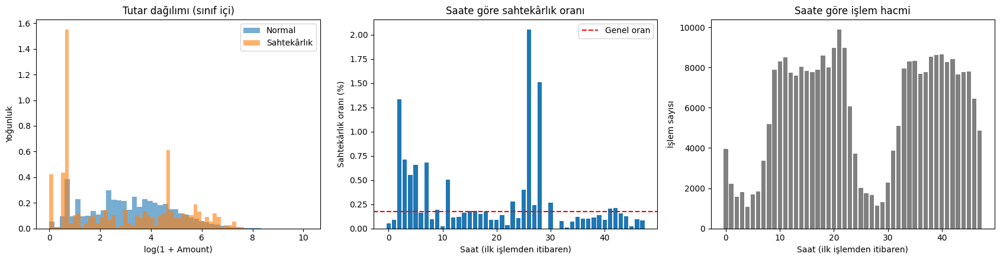
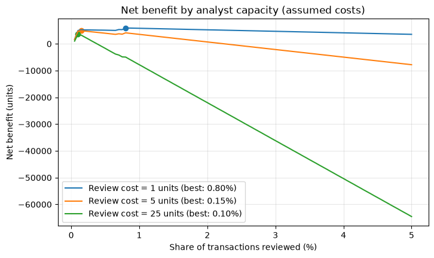
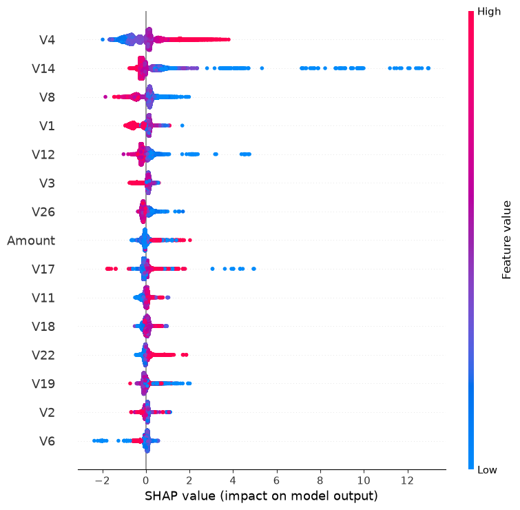

# Credit Card Fraud Detection

Fraud detection on the Kaggle *Credit Card Fraud Detection* dataset, with the evaluation designed around two practical questions: does the result hold when the model is tested on *later* transactions, and how many alerts must an analyst review to catch most fraud?

The emphasis is on honest evaluation rather than a leaderboard score: duplicates are removed before splitting, the split is by time, the test set is used once, and limitations are stated next to the results.

Kaggle notebook: <KAGGLE_LINKI>

## Problem and business context

Fraud is very rare but every missed case is a direct loss; every false alarm costs analyst time and annoys a customer. Accuracy is meaningless here (predicting "normal" for everything scores 99.83%), so the primary metric is **PR-AUC**, supported by recall/precision at a fixed review budget. A random model's PR-AUC is about the fraud rate (~0.0017).

## Data and data quality findings

- 284,807 transactions, 492 frauds (0.173%), no missing values. Features are anonymous PCA components `V1`–`V28`, plus `Time` and `Amount`.
- **Duplicates:** 1,081 fully duplicated rows (1,062 normal, 19 fraud) were removed *before* splitting to avoid train/test leakage. 283,726 transactions and 473 frauds remain. Rows are identical in every column including `Time`, so they are most likely record duplicates (an inference, not verified).
- **Time window:** `Time` spans 0–172,792 s (~48 hours). Fraud rate is higher at night (hour 2: 1.33%, hour 26: 2.05%, hour 28: 1.51% vs 0.17% overall), but there are also bursts (hour 11: 43 frauds, hour 26: 36). With only two days, a time-of-day effect cannot be separated from these bursts, so **`Time` and `Hour` are not used as model inputs.**
- **Amount:** fraud median 9.25 vs 22 for normal transactions; fraud amounts cluster around ~0, ~1 and ~100. Small amounts may be card testing (hypothesis, not verified).



## Validation design

- **Time-based split:** sort by `Time`, last 20% is the test set (train 226,980 transactions / 399 frauds; test 56,746 / 74 frauds, the last ~7.7 hours; test fraud rate 0.130% vs 0.176% in train). This mimics deploying on future data.
- **Test set used once**, for the final model only. Model selection uses cross-validation inside the training part.
- **Two CV schemes on train:** stratified 5-fold, and time-based (`TimeSeriesSplit`, 4 folds; validation folds contain 47–89 frauds). SMOTE is applied only to each fold's training part (imbalanced-learn `Pipeline`).
- **Reading the gap:** all models except the unstable `scale_pos_weight` variant score lower under time-based CV. Part of this may be distribution shift into the future; part is that early time-based folds train on less data (fold 1 uses ~20% of the data). Stratified CV is the more optimistic estimate.

## Cross-validation results (train only, mean ± std)

| Model | PR-AUC strat. | PR-AUC time | ROC-AUC strat. | ROC-AUC time | Top 0.5% capture strat. | Top 0.5% capture time |
|---|---|---|---|---|---|---|
| LightGBM | 0.829 ± 0.031 | 0.758 ± 0.041 | 0.977 ± 0.006 | 0.963 ± 0.028 | 0.875 ± 0.032 | 0.814 ± 0.054 |
| LightGBM + SMOTE | 0.856 ± 0.020 | 0.755 ± 0.052 | 0.977 ± 0.007 | 0.958 ± 0.029 | 0.875 ± 0.015 | 0.811 ± 0.055 |
| LightGBM (scale_pos_weight=√ratio) | 0.367 ± 0.258 | 0.542 ± 0.323 | 0.859 ± 0.042 | 0.899 ± 0.060 | 0.692 ± 0.110 | 0.693 ± 0.170 |
| Logistic Regression | 0.742 ± 0.021 | 0.526 ± 0.192 | 0.971 ± 0.010 | 0.940 ± 0.027 | 0.857 ± 0.021 | 0.714 ± 0.088 |
| Logistic Reg. (balanced) | 0.718 ± 0.015 | 0.651 ± 0.149 | 0.970 ± 0.006 | 0.939 ± 0.039 | 0.855 ± 0.024 | 0.785 ± 0.051 |
| Logistic Reg. + SMOTE | 0.744 ± 0.013 | 0.721 ± 0.083 | 0.969 ± 0.010 | 0.944 ± 0.031 | 0.857 ± 0.026 | 0.801 ± 0.055 |
| Isolation Forest (unsupervised) | 0.191 ± 0.042 | 0.095 ± 0.113 | 0.946 ± 0.019 | 0.930 ± 0.036 | 0.448 ± 0.060 | 0.272 ± 0.182 |

Findings:

- ROC-AUC barely separates the models (0.93–0.98 apart from the unstable variant; a single feature, V14, already reaches ~0.95), so PR-AUC decides.
- **LightGBM** had the highest PR-AUC in 3 of 4 time-based folds (balanced logistic regression won fold 3: 0.814 vs 0.783).
- **SMOTE** did not help LightGBM under time-based CV (0.758 → 0.755, within one std). For logistic regression it went 0.526 → 0.721, but the stds (0.192 and 0.083) make the difference uncertain. SMOTE was not added to the final model.
- **Isolation Forest** (no labels) finds part of the fraud but is clearly below the supervised models; PR-AUC is low despite ROC-AUC of 0.93–0.95.
- **`scale_pos_weight`=√ratio (~24)** made LightGBM unstable in both schemes (stratified fold PR-AUCs 0.608 / 0.677 / 0.126 / 0.162 / 0.263; last time-based fold 0.068). The cause was not investigated; hypothesis: memorisation of the few positives. It was dropped from the final candidates.
- Plain vs. balanced logistic regression ranks differently by scheme, so no clear conclusion about class weights.

## Final test results

Final model: LightGBM without SMOTE, near-default settings (no hyperparameter tuning), fitted on the training part and evaluated once on the test set (56,746 transactions, 74 frauds).

| Metric | Point estimate | 95% bootstrap interval |
|---|---|---|
| PR-AUC | 0.733 | 0.622 – 0.843 |
| ROC-AUC | 0.982 | 0.965 – 0.995 |
| Top 0.5% capture | 0.851 | 0.761 – 0.928 |

The result is consistent with time-based CV (PR-AUC 0.758 ± 0.041). The bootstrap (500 resamples) resamples transactions independently, so it ignores fraud clustering; the real uncertainty is probably larger. The test window is only ~7.7 hours, so this is a measurement for that window.

## Analyst capacity and net benefit

Test set, transactions ranked by model score:

| Reviewed (%) | Reviewed transactions | Frauds caught (of 74) | Precision | Recall | Fraud amount caught |
|---|---|---|---|---|---|
| 0.10 | 56 | 50 | 0.893 | 0.676 | 0.627 |
| 0.25 | 141 | 60 | 0.426 | 0.811 | 0.737 |
| 0.50 | 283 | 63 | 0.223 | 0.851 | 0.739 |
| 1.00 | 567 | 65 | 0.115 | 0.878 | 0.822 |
| 2.00 | 1,134 | 66 | 0.058 | 0.892 | 0.824 |

Returns diminish quickly. The share of fraud *amount* caught is lower than recall (at 0.5%: 73.9% vs 85.1%), i.e. missed frauds are larger on average; amount-weighted training was not tried.

**Net benefit = fraud amount caught − review cost × transactions reviewed.** The review costs (1, 5 and 25 units) are **assumptions, not real costs**; the currency is unknown, so "units" are used. With these costs the best review share is 0.75% / 0.20% / 0.10%. The total fraud amount in the test set is only 7,728 units over 74 frauds in one short window, so the optimum points are not precise. Chargebacks and customer friction are not modelled.



## Explainability (SHAP)

Features are anonymous PCA components, so SHAP can say *which* components matter, not *what they mean*. On the test set (log-odds scale):

- Mean |SHAP|, all transactions: V4 0.621, V14 0.335, V8 0.324, V1 0.299, V12 0.179.
- Mean |SHAP|, frauds only (74 transactions): V14 6.766, V10 2.601, V4 1.949, V12 1.516, V17 1.221. V10 is not in the top 15 overall.
- In the beeswarm plot, risk rises when V14 and V12 are low and V4 is high. `Amount` ranks 7th overall (0.107) and is not in the top 10 for frauds.



## Limitations

- A single ~48-hour window; the test set holds 74 frauds. Results are a measurement for this window and the uncertainty is wide. The bootstrap ignores fraud clustering.
- That duplicates are record duplicates is an inference, not verified.
- Anonymous PCA features: limited explainability and no feature engineering.
- `Time`/`Hour` were left out; the time-of-day effect cannot be separated from the two fraud bursts. The card-testing reading of the amount clusters (~0, ~1, ~100) is a hypothesis.
- No LightGBM hyperparameter tuning; the instability of `scale_pos_weight` was not investigated; the plain vs. balanced logistic ranking depends on the scheme.
- Net benefit is hypothetical and counts only caught amounts; unknown currency; no chargeback or customer-friction costs. Optimal review shares are not exact.
- Amount-weighted training was not tried.

## Repository layout

```
notebooks/   original Kaggle notebook (outputs preserved; Turkish commentary)
src/         data.py, models.py, evaluate.py, explain.py, pipeline.py
tests/       unit tests on small synthetic data
docs/figures figures extracted from the notebook outputs
data/        download instructions only (the CSV is not committed)
```

## How to run

```bash
pip install -r requirements.txt
kaggle datasets download -d mlg-ulb/creditcardfraud -p data --unzip   # see data/README.md
python -m src.pipeline --data-path data/creditcard.csv --output-dir outputs
pytest
```

The pipeline runs both CV schemes on the training part, fits the final LightGBM, evaluates once on the test set, and writes tables and figures to `outputs/`. Options: `--skip-cv`, `--skip-shap`, `--n-boot`, `--test-frac`.

Note: the numbers above come from the original notebook run on Kaggle. The refactored `src/` code has been tested on small synthetic data only; it has not been run on the real dataset, so re-running it may differ slightly (library versions, thread nondeterminism).

## License

MIT, see [LICENSE](LICENSE).
